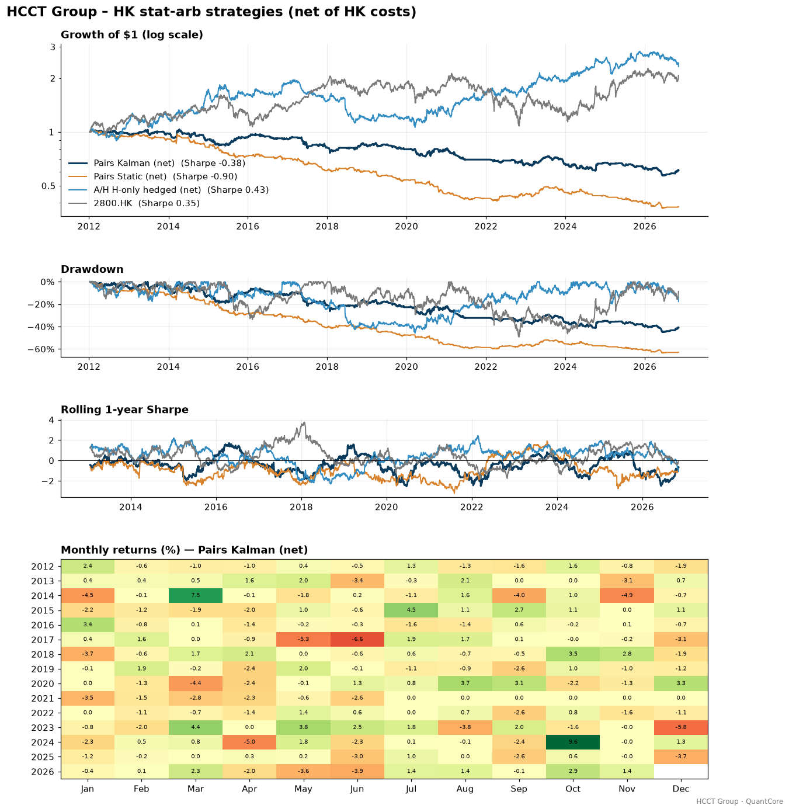
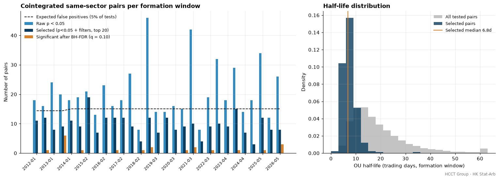
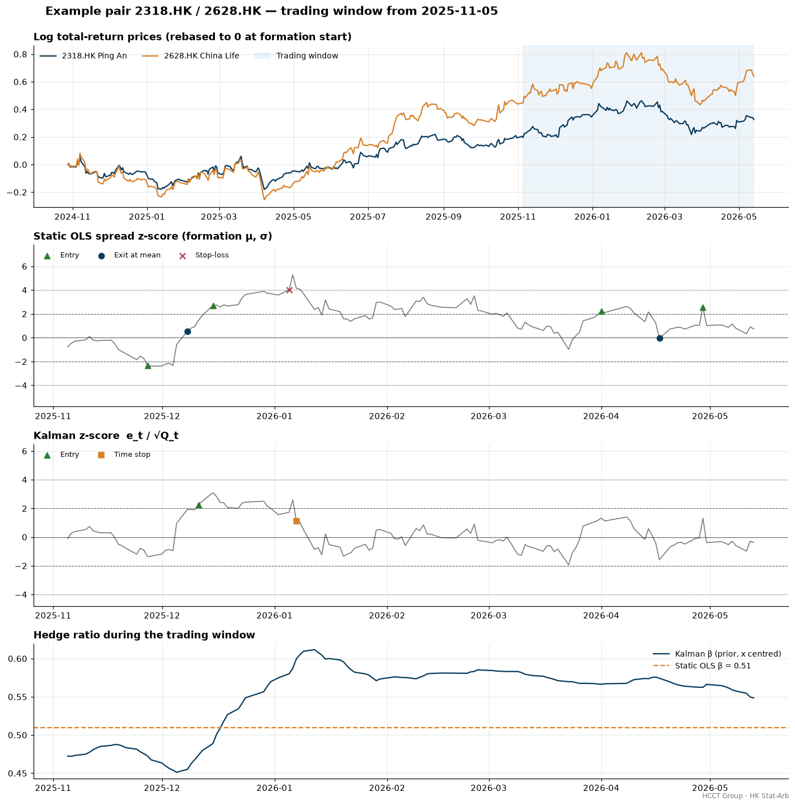
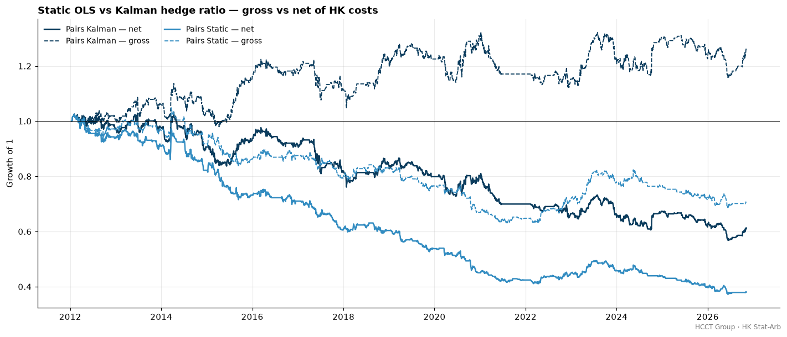
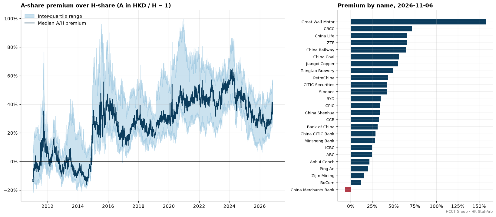
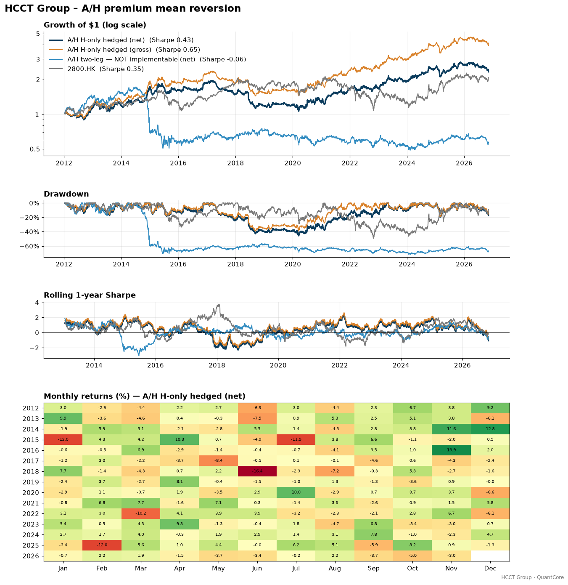
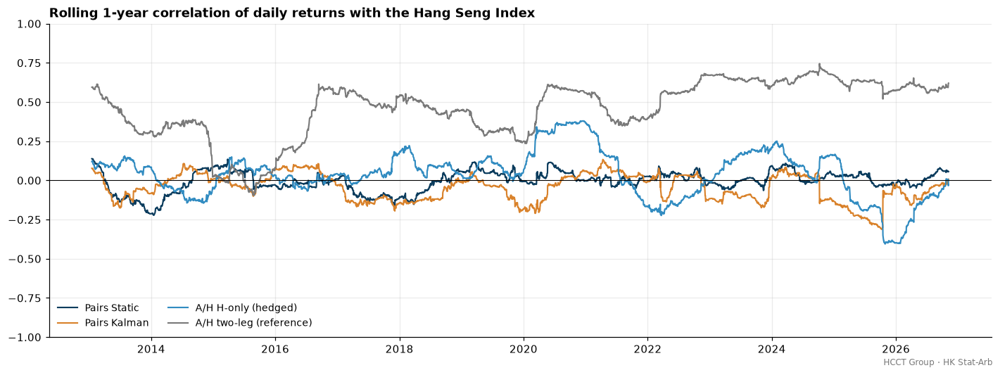

# HCCT Group – HK Stat-Arb

**Hong Kong statistical arbitrage: cointegration pairs, Kalman hedge ratios and A/H-share premium mean reversion.**
Created by **Harry CHU** · HCCT Group

[](https://github.com/hcctbusiness/HK-Stat-Arb/actions/workflows/ci.yml)


This repository tests two classic Hong Kong relative-value ideas on 2012–2026 data, using realistic HK trading costs. The first is **same-sector pairs trading** across 62 liquid HK stocks, with a static OLS hedge ratio compared against a Kalman-filter hedge ratio. The second is **A/H-share premium mean reversion** across 25 dual-listed Chinese companies. Every parameter was fixed before the first run and none were tuned on the sample. Backtesting runs on [QuantCore](https://github.com/hcctbusiness/QuantCore), the shared HCCT Group engine. Every number below comes from `python run_hk_statarb.py`.



## Methodology

| Step | Implementation |
|---|---|
| Data | Yahoo Finance (via `quantcore.data`), 2011-01 → today. Dividend-adjusted closes for returns and pair formation. **Unadjusted** closes for the A/H premium (see below). |
| Calendar | Hong Kong trading days. Gaps are forward-filled for at most 5 bars. |
| Pairs universe | 62 HK large caps in 6 sectors (banks & insurers, property, telecom & tech, utilities, energy & materials, consumer), hard-coded in `universe.py` |
| Windows | 252-day formation, then 126-day trading, re-formed every 126 days (29 windows). Positions still open at the end of a trading window are closed. |
| Pair tests | Engle-Granger on log prices, every same-sector pair (~300 tests per window). Both regression directions are tested and the smaller p-value is doubled, so choosing the direction is not a free option. |
| Multiple testing | **Primary:** p < 0.05, half-life 2–63 days, β ∈ [0.5, 2], keep the top 20 by p-value. The expected number of false positives (5% of tests) is reported next to the count found. **Robustness:** trade only pairs that survive Benjamini-Hochberg FDR at q = 0.10. |
| Half-life | OU/AR(1) fit on the formation residual: Δs = c + λs₋₁, half-life = −ln 2 / ln(1+λ) |
| Static hedge | Formation OLS (α, β). z = (s − μ_form) / σ_form |
| Kalman hedge | State θ = [β, α] follows a random walk with W = diag(1e-5, 1e-6), observation noise V_e = formation residual variance, x centred on its formation mean. The filter starts at the formation OLS estimate. z = e_t / √Q_t, using the **prior** (pre-update) forecast only. Implemented in numpy (`kalman.py`). |
| Signals | Enter when \|z\| > 2. Exit when z crosses 0. Stop-loss at \|z\| > 4. Time stop after 3 × half-life. After a stop, the pair is disarmed until z crosses 0 again. |
| Pairs portfolio | Each pair is dollar-neutral (+g/2 / −g/2), with equal ex-ante risk: g = min(1, 2 × 5% / σ_ann(r_y − r_x)). Total gross is capped at 3×. The book is left to drift between trades, so costs arise only on entries and exits. |
| A/H premium | A close (CNY) × CNYHKD of the **previous** FX bar ÷ H close (HKD) − 1. The A close is the latest on or before the HK date (Shanghai/Shenzhen close before HK), at most 5 bars stale. |
| A/H strategy (implementable) | At each month end, z-score each name's premium against its own trailing 252 days. Buy the 5 H shares with the highest z (H unusually cheap vs A) equal-weight, and short 2800.HK sized by trailing 252-day betas. Only H shares and the Tracker Fund are traded. |
| A/H control | All names with a valid signal, equal-weight, same beta hedge. This separates the signal from the universe. |
| A/H two-leg | Same names, long H / short A (in HKD). **Reference only, not implementable** (see below). |
| Costs | 3 bp commission (incl. exchange/SFC/FRC levies) + 5 bp slippage on every trade, **10 bp stamp duty per side on HK stock trades** (2800.HK is ETF-exempt), 150 bp/yr borrow on gross shorts. Two-leg A legs: 5 bp stamp, 800 bp/yr borrow. |

Signals use only data up to the close of day *t*. QuantCore's `lag=1` then applies them to returns from *t+1*. Unit tests confirm that changing future prices leaves past pair weights, Kalman z-scores and premium z-scores unchanged. As an execution-delay check, every strategy is also traded one bar late.

**Why the A/H premium uses unadjusted prices.** Yahoo's dividend adjustment scales history by each listing's own dividend yield. A and H shares pay the same dividend, but the H line usually has a much higher yield. Back-adjusted prices would therefore shrink the historical premium on the H side and bias it over time. Returns still come from total-return series.

**Stamp duty simplification.** HK stamp duty was 0.10% per side until July 2021, 0.13% from August 2021 to November 2023, and 0.10% since. This study uses 0.10% throughout, which slightly flatters 2021–23.

**One disclosed adjustment.** Pair sizing (risk per pair 2% → 5%, gross cap 2× → 3×) was raised once after the first run because portfolio volatility was only ~3%. This scales returns and costs together and does not change any Sharpe ratio. No signal, filter or window parameter was ever changed.

## Results on real data

Strategy period **2012-01-11 → 2026-11-06**, daily returns. Full output, including every formation window, trade statistics and the A/H premium table, is in [`docs/results.md`](docs/results.md).

**Main results (net of HK costs)**

| Metric | Pairs Static | Pairs Kalman | A/H H-only (hedged) | A/H control (hedged) | A/H two-leg (not implementable) | 2800.HK |
|---|---:|---:|---:|---:|---:|---:|
| CAGR | -6.45% | -3.34% | 5.99% | 3.53% | -3.82% | 5.17% |
| Ann. Vol | 7.12% | 8.04% | 16.61% | 11.44% | 22.73% | 20.61% |
| Sharpe | -0.90 | -0.38 | 0.43 | 0.36 | -0.06 | 0.35 |
| Max Drawdown | -63.72% | -44.96% | -45.84% | -26.67% | -71.73% | -49.39% |
| Sharpe (gross) | -0.30 | 0.24 | 0.65 | 0.51 | 0.45 | 0.35 |
| CAGR (gross) | -2.37% | 1.61% | 9.93% | 5.33% | 7.85% | 5.17% |
| Annual cost drag | 4.27% | 5.00% | 3.65% | 1.73% | 11.46% | 0.00% |
| …of which stamp duty | 2.10% | 2.49% | 1.11% | 0.08% | 1.67% | 0.00% |
| Beta vs HSI | 0.00 | -0.01 | 0.03 | 0.02 | 0.46 | 0.98 |
| Correlation vs HSI | 0.01 | -0.04 | 0.04 | 0.04 | 0.42 | 0.98 |

**Cost sensitivity (Sharpe; all cost components scaled together)**

| Cost scenario | Pairs Static | Pairs Kalman | A/H H-only (hedged) | A/H two-leg (ref.) |
|---|---:|---:|---:|---:|
| 0× (gross) | -0.30 | 0.24 | 0.65 | 0.45 |
| 0.5× | -0.60 | -0.07 | 0.54 | 0.20 |
| 1× (base) | -0.90 | -0.38 | 0.43 | -0.06 |
| 2× | -1.48 | -1.00 | 0.21 | -0.56 |
| Break-even cost multiple | gross ≤ 0 | 0.38× | 2.98× | 0.89× |

**Pair formation (29 windows)**

| Statistic | Value |
|---|---:|
| Same-sector pairs tested per window | 299 |
| Raw p < 0.05 per window (avg) | 20.6 |
| Expected by chance at 5% | 15.0 |
| Significant after BH-FDR q = 0.10 (avg) | 0.7 |
| Windows with zero BH-significant pairs | 17 of 29 |
| Selected pairs still p < 0.05 in the next window | 14% |
| Selected half-life, median (IQR) | 6.8 days (5.6–8.6) |
| Round trips (static / Kalman) | 361 / 421 |
| Exits by stop-loss (static / Kalman) | 29.9% / 9.0% |
| Exits at the mean (static / Kalman) | 11.6% / 33.5% |



## Reading the results honestly

- **Pairs trading does not work here after costs.** Neither version makes money net of HK costs (Sharpe −0.90 static, −0.38 Kalman). The static version loses money even before costs. Stamp duty alone costs 2.1–2.5% a year, about half of all trading costs, because every round trip pays 0.10% on four legs. The Kalman version has a small positive gross edge (Sharpe 0.24, +1.6% a year), but that edge disappears at 0.38× today's costs. HK pairs trading would need far lower turnover, or a stamp-duty-free instrument, to be viable.
- **Most "cointegrated" pairs are statistical noise.** About 300 same-sector tests per window produce about 21 pairs with p < 0.05, against 15 expected by pure chance. After Benjamini-Hochberg, fewer than one pair per window is significant, and 17 of 29 windows have none. Only 14% of selected pairs are still cointegrated in the following window. Trading only the BH-significant pairs barely trades at all and still loses money (Sharpe −0.28 / −0.42 on near-zero exposure). The top-20-by-p rule mainly picks pairs that happened to mean-revert quickly during formation; their median half-life of 6.8 days is short.
- **Kalman beats static, but only as a signal.** A static hedge ratio fixed on last year's data drifts out of date. Static trades end in stop-losses 30% of the time and at the mean only 12% of the time. The adaptive Kalman hedge reverses that (9% stops, 34% mean exits, 53% gross win rate) and adds about 0.5 Sharpe gross. It also trades more, so the improvement is eaten by costs.
- **The pairs books are genuinely market-neutral.** Their correlation with the HSI is 0.01 / −0.04 and their beta is about zero, as dollar-neutral same-sector pairs should be. The losses do not come from market exposure.
- **The implementable A/H strategy is the only positive result, and most of it is the universe, not the signal.** The H-only book (long H shares that are cheap vs their own A-share history, beta-hedged with 2800.HK) earned +6.0% a year net with Sharpe 0.43 and beta 0.03. It survives up to about 3× today's costs and a one-day execution delay (Sharpe 0.43). However, an equal-weight hedged basket of *all* 25 H shares already earned +3.5% net (Sharpe 0.36). The premium signal adds +3.1% a year net over that control with t ≈ 1.0 (gross +5.0%, t ≈ 1.6), which is **not statistically significant** over 14.5 years.
- **The two-leg A/H trade is a cautionary tale even before you try to short A-shares.** Convergence earned 7.9% a year gross. The trade then lost half its value in late 2014, when the Shanghai–Hong Kong Stock Connect launch and the mainland rally pushed the median premium from −16% to over +30% within months. Net of A-share borrow and two sets of costs it lost money (−3.8% a year). It also carries 0.46 HSI beta, because H shares track Hong Kong while A shares do not. Premiums can widen for years: the median premium was negative in 2014 and peaked at 65% in March 2024.

**Conclusion:** on this evidence, classic cointegration pairs trading in Hong Kong large caps is killed by stamp duty and by unstable cointegration. The A/H premium is a real and persistent feature, and an H-only, beta-hedged implementation produced a modest positive, market-neutral return. Most of that return, however, comes from holding the dual-listed universe rather than from the premium signal. It deserves further work (point-in-time universe, larger cross-section, longer holding periods), not capital.







## Why the two-leg A/H trade is not implementable

Foreign investors reach A shares through Northbound Stock Connect, which does not allow naked short selling. Mainland securities lending is scarce, expensive and often unavailable for the names you want to short. The H-only design keeps the part of the trade you can actually hold from Hong Kong (the cheap H shares) and replaces the A-share short with a liquid, stamp-duty-exempt index hedge (2800.HK).

## Limitations

- **Survivorship bias.** Both universes are today's large, liquid survivors, picked in hindsight. Delisted names (e.g. HK-listed companies privatised or merged since 2012) are missing. The A/H list includes BYD and Great Wall Motor, which are among the most-held names and big long-run winners. This likely flatters the A/H long book and its control. A professional study would use point-in-time HSI/HSCEI and AH-index membership.
- **Short availability in Hong Kong.** Only designated securities on the HKEX short-selling list can be shorted, and borrow can be recalled. The pairs universe consists of large caps that are generally designated, but borrow availability and its cost (a flat 150 bp/yr here) varied over time and can spike in stress.
- **Costs are linear.** There is no market impact, odd-lot or board-lot rounding, or minimum commission, and stamp duty is simplified to 0.10% throughout (it was 0.13% in 2021–23). Trades execute at the signal-day close (QuantCore convention). The +1-day delay test shows little sensitivity.
- **Holiday misalignment.** HK and mainland holidays differ (Golden Week, Lunar New Year). A-share prices are carried forward for at most 5 HK bars, so the premium can be stale around mainland holidays. FX uses the previous day's bar.
- **Yahoo Finance data quality.** Free data can contain bad ticks, missing days and adjustment errors. Unadjusted closes are split-adjusted only. Dividends paid on different A and H ex-dates create small temporary premium jumps.
- **Pair-test simplifications.** Engle-Granger only (no Johansen). Dollar-neutral legs, with the hedge ratio used to define the signal rather than the leg sizes (the Gatev–Goetzmann–Rouwenhorst convention). β is restricted to [0.5, 2] to limit the mismatch.

## Quick start

```bash
git clone https://github.com/hcctbusiness/HK-Stat-Arb.git
cd HK-Stat-Arb
pip install -e ".[dev]"      # pulls QuantCore from GitHub
pytest -q                    # 13 offline tests on synthetic data
python run_hk_statarb.py     # downloads data, regenerates docs/ (~5 min)
```

```python
import numpy as np
from hk_statarb import pairs, costs, data
from hk_statarb.universe import TICKERS, SECTOR_OF

px = data.total_return_prices(TICKERS, start="2011-01-01").ffill(limit=5)
res = pairs.run_pairs(px, SECTOR_OF, method="kalman")      # walk-forward formation + trading
bt = costs.run(res.weights, px, costs.HKCosts(), "Pairs Kalman")   # QuantCore + HK stamp duty
print(res.windows.tail(), bt.stats())
```

## Project structure

```
src/hk_statarb/
  universe.py       # HK sector universe, A/H dual listings, benchmark tickers
  data.py           # total-return & unadjusted closes, as-of calendar alignment, lagged FX
  cointegration.py  # Engle-Granger, OLS hedge, OU half-life, Benjamini-Hochberg, pair selection
  kalman.py         # numpy Kalman filter for a time-varying hedge ratio
  signals.py        # z-score entry/exit/stop/time-stop state machine
  pairs.py          # rolling formation/trading engine, equal-risk dollar-neutral drifted book
  ah.py             # A/H premium, premium z-scores, H-only / control / two-leg portfolios
  costs.py          # HK cost model: QuantCore costs + per-asset stamp duty and borrow
  plots.py          # formation, example pair, A/H premium, neutrality charts
run_hk_statarb.py   # reproduces every chart and table in this README
tests/              # offline unit tests (cointegration, Kalman, half-life, signals, look-ahead, neutrality, FX)
```

## HCCT Group quant research series

| Project | Focus |
|---|---|
| [QuantCore](https://github.com/hcctbusiness/QuantCore) | Backtesting engine |
| [Macro-AI-Copilot](https://github.com/hcctbusiness/Macro-AI-Copilot) | Macro regime detection → multi-asset allocation |
| [Equity Factor Model](https://github.com/hcctbusiness/Equity-Factor-Model) | Cross-sectional factors, long/short, IC analysis |
| **HK Stat-Arb** | Cointegration pairs and A/H-share premium (this repo) |
| Multi-Asset Trend Following | Futures-style CTA with vol targeting |
| ML Alpha Lab | Purged CV, meta-labelling, gradient boosting |
| Portfolio & Risk Engine | HRP, risk parity, Black-Litterman, VaR |

## Disclaimer

For research and education only. Not investment advice. Past performance does not guarantee future results.

---
© 2026 Harry CHU · HCCT Group · MIT License
